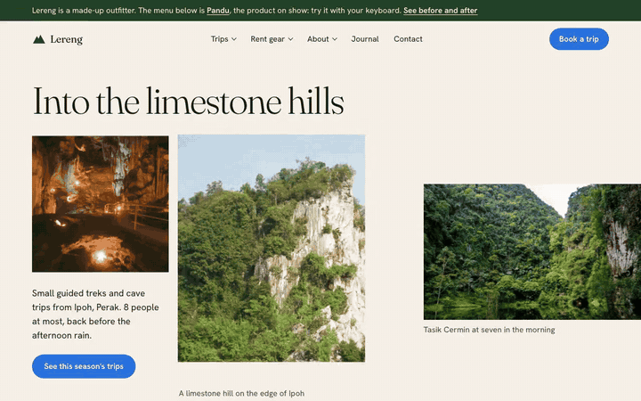

# Pandu

Accessible, framework-free site navigation. Pandu (Malay for *guide*) turns the plain list of links your server already renders into dropdowns, a mega-menu and a mobile drawer.

- **Live demo:** https://pandu-nav.pages.dev (setup notes at [/pandu/](https://pandu-nav.pages.dev/pandu/), [before and after](https://pandu-nav.pages.dev/pandu/before-after/))
- **Staging:** https://staging.pandu-nav.pages.dev
- **Size:** `pandu.min.css` 2.5 KB + `pandu.min.js` 4.6 KB, gzipped. No dependencies.



## What it does

- Progressive enhancement: every item is a real `<a href>`, so existing routes are untouched and the menu works with JavaScript off (panels open on hover and focus, the drawer opens with `:target`).
- WAI-ARIA **disclosure navigation** pattern (not `role="menu"`): buttons with `aria-expanded` and `aria-controls`, `aria-current="page"`, DOM order equals tab order.
- Keyboard: Tab/Shift+Tab, Enter/Space toggle, Esc closes and returns focus, ←/→ between top-level items, ↓/↑ into and through a panel, Home/End. Focus is never trapped on desktop.
- Mobile (down to 320 px): labelled Menu button, off-canvas drawer, focus moved in and returned, page behind made `inert` and scroll-locked, sections as accordions.
- Hover with intent delay (mouse only), click outside to close, `prefers-reduced-motion`, `forced-colors`, 44 px targets, no layout shift.
- Themed entirely with `--pandu-*` custom properties. Optional JSON config via `Pandu.mount()`.

## Install

```html
<link rel="stylesheet" href="/assets/pandu.min.css">
<script src="/assets/pandu.min.js" defer></script>
```

Then render the markup shown in [the docs](https://pandu-nav.pages.dev/pandu/#markup) (or view the source of [/pandu/example/](https://pandu-nav.pages.dev/pandu/example/)). The script starts itself on every `[data-pandu]` element.

## Repository

| Path | What |
|---|---|
| `src/pandu.css`, `src/pandu.js` | The component (readable sources) |
| `dist/` | Built files: `pandu.css`, `pandu.js`, `pandu.min.css`, `pandu.min.js`, `sizes.json` |
| `site/` | The demo site: pages, the nav partial, static files |
| `tools/build.mjs` | Minifies `dist/` and renders the site into `public/` |
| `tools/check.mjs` | Real-browser checks in Chromium, Firefox and WebKit (keyboard, drawer, no-JS, overflow at 320 px, console, axe-core) |
| `tools/record-demo.mjs` | Records the demo MP4/GIF with Playwright and ffmpeg |
| `tools/deploy.sh` | Deploys `public/` to Cloudflare Pages (`main` or `staging`) |

```bash
npm install
npm run dev                  # build and serve on http://localhost:4321
node tools/check.mjs         # run the browser checks against it
./tools/deploy.sh staging    # preview deploy; ./tools/deploy.sh for production
```

## Credits

Demo photographs are from Wikimedia Commons under their licences (listed on [/credits/](https://pandu-nav.pages.dev/credits/)). Lereng Outfitters is a fictional business. Fonts: Fraunces and Hanken Grotesk (SIL OFL). Design language follows `DESIGN.md`.

MIT © 2026 Luqman Hakeem
